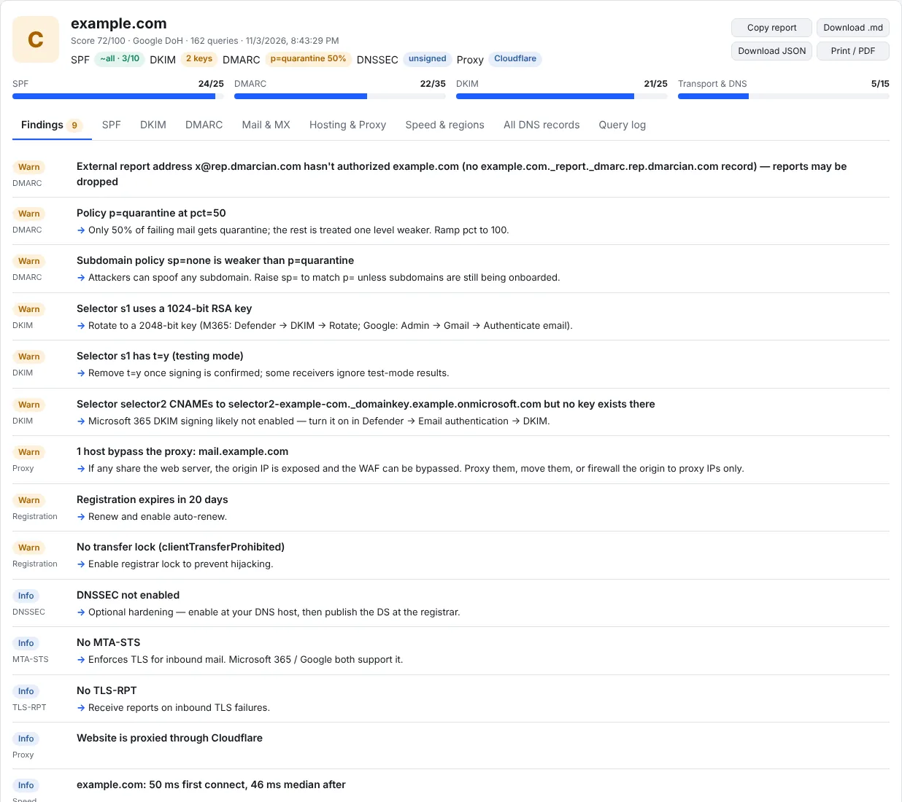
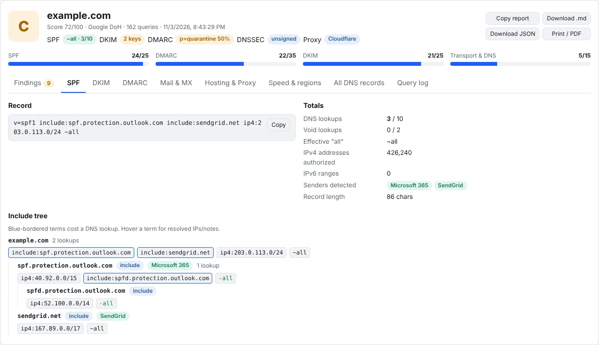
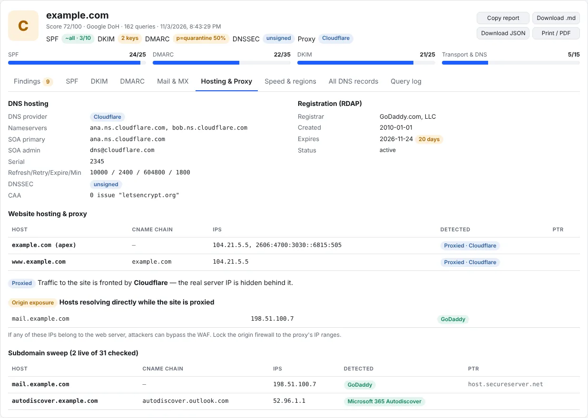
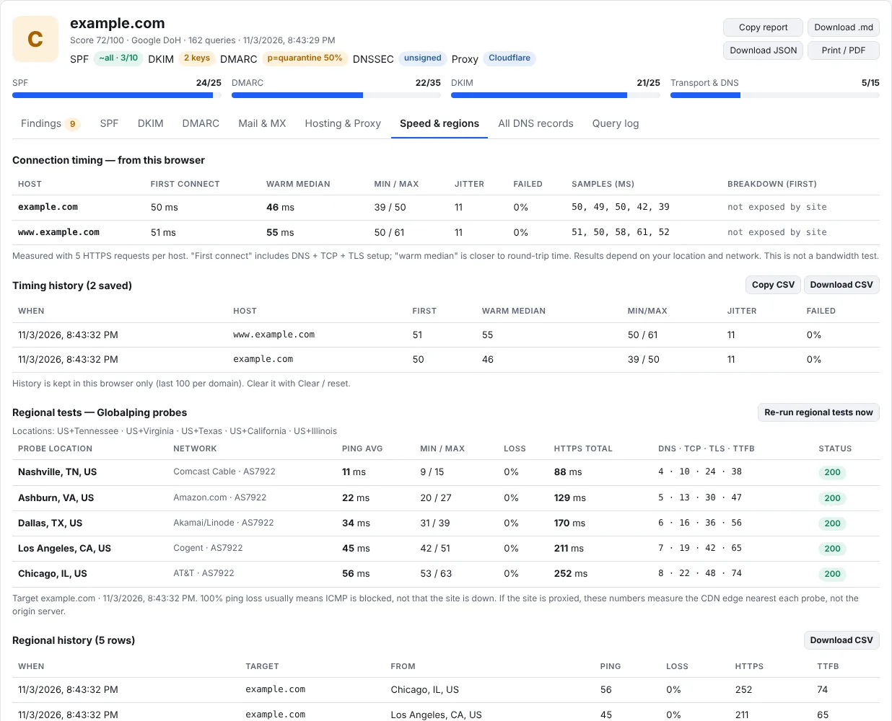
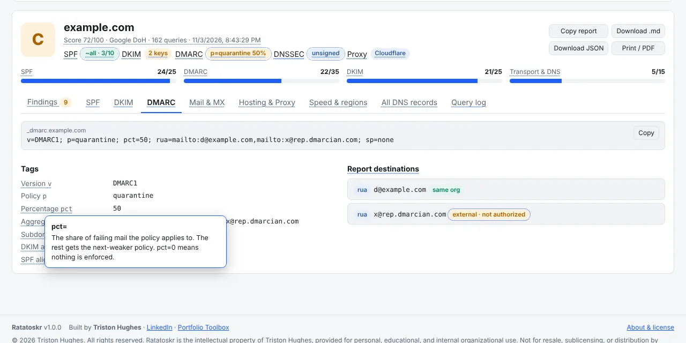

# Ratatoskr — DNS Inspector

**Check a domain's email authentication (SPF, DKIM, DMARC), pull every relevant DNS record, detect proxies and CDNs, and measure response times from your browser and from regions around the world, in one page.**

Ratatoskr is a single HTML file. There's nothing to install and no server of its own. Open it in any modern browser, type a domain, and click **Run checks**.

### ▶ [Launch Ratatoskr in your browser](https://caitous.github.io/Ratatoskr-DNS-Inspector/) &nbsp;·&nbsp; ⬇ [Download the latest release](https://github.com/CAITOUS/Ratatoskr-DNS-Inspector/releases/latest)

> In Norse myth, Ratatoskr is the squirrel who runs messages up and down the world tree. This one carries your questions to the world's DNS and brings back what it says about a domain.



---

## What it does

- **Graded email security.** A score out of 100 (SPF 25, DMARC 35, DKIM 25, transport/DNS 15), with every finding ranked Fail / Warn / Info / Pass and an actionable fix, plus ready-to-paste suggested records.
- **SPF deep check.** Expands the full include tree, counts DNS lookups against the 10-lookup limit, flags void lookups, `+all`/`?all`, `ptr`, broad ranges, duplicate records, and senders missing for the detected mail platform.
- **DKIM discovery.** Probes ~60 common selectors (plus your own), reports key type and size, test mode, revoked keys, wildcard false positives, and Microsoft 365 / Google Workspace DKIM that was never switched on.
- **DMARC analysis.** Every tag explained and validated, including `pct=0` (monitoring only), weak subdomain policies, inherited policies, and whether external report addresses have authorised you.
- **Mail transport.** MX health and provider, null MX, MTA-STS, TLS-RPT, BIMI, Microsoft 365 client records, and a "SaaS footprint" from verification TXT records.
- **Hosting and proxies.** DNS provider, SOA, DNSSEC, CAA, registration and expiry (RDAP), website hosting, Cloudflare and other proxies/WAFs/CDNs, a subdomain sweep, **origin-exposure** detection, and internal IPs leaked into public DNS.
- **Speed.** HTTPS timing from your browser (first connect, warm median, jitter, failures) and optional **regional tests** from [Globalping](https://globalping.io) probes in locations you choose, with saved history.
- **Batch mode.** Check many domains at once; summary table with CSV export.
- **Privacy guard.** Blocklist IPs, ranges or hosts so they're never sent to outside services; private ranges are always withheld.
- **Explain mode.** Turn on **? Explain** and hover anything underlined for a plain-English explanation.
- **Exports.** Markdown report, JSON, CSV, zone-file text, and print-to-PDF.

| | |
|---|---|
|  |  |
|  |  |

---

## Quick start

1. **Open Ratatoskr**, either way:
   - **In your browser:** [caitous.github.io/Ratatoskr-DNS-Inspector](https://caitous.github.io/Ratatoskr-DNS-Inspector/). Nothing to download.
   - **Offline copy:** download `Ratatoskr.html` (app only) or `ratatoskr-<version>.zip` (app + guides + license) from [Releases](https://github.com/CAITOUS/Ratatoskr-DNS-Inspector/releases/latest), then open `Ratatoskr.html`.
2. **Enter one or more domains** (one per line) and click **Run checks**. `Ctrl+Enter` also runs.
3. **Optional:** set up **Regional tests** (locations, extra targets) and the **Privacy guard** blocklist. Both are remembered in your browser.

Tip: link straight to a check with `…/Ratatoskr.html#example.com`.

## Requirements

- Any modern browser (Chrome, Edge, Brave, Firefox, Safari).
- Network access to `dns.google` or `cloudflare-dns.com`. Opening the file inside sandboxed viewers (embedded previews, some mail clients) blocks these calls. Open the downloaded file directly.

## Privacy

Ratatoskr has no backend and no analytics. Lookups go straight from your browser to the public DNS-over-HTTPS resolver you choose; optional features call `rdap.org`, Globalping, the target website itself, and the public `ratatoskr.json` update file. Settings and history stay in your browser. Details: [docs/SECURITY.md](docs/SECURITY.md).

## Repository contents

```
Ratatoskr.html         The app (single file)
index.html             Opens Ratatoskr.html when the site is visited (GitHub Pages)
.nojekyll              Serve files as-is on GitHub Pages
.github/workflows/     Release workflow: builds the download package for each version
ratatoskr.json         Version file that copies of Ratatoskr check for updates
docs/                  Security & data handling, releasing, screenshots
LICENSE.md             License terms
CHANGELOG.md           Version history
```

---

## License

© 2026 Triston Hughes. All rights reserved. Ratatoskr is free for **personal, educational and internal organisational use**. It is **not** for resale, sublicensing, distribution by value-added resellers (VARs), or provision to other organisations as a paid service. Reports you create with Ratatoskr belong to you. See [LICENSE.md](LICENSE.md).

---

Built by **Triston Hughes** · [LinkedIn](https://www.linkedin.com/in/triston-hughes-949420242/) · [Portfolio Toolbox](https://triston-hughes.vercel.app/)
